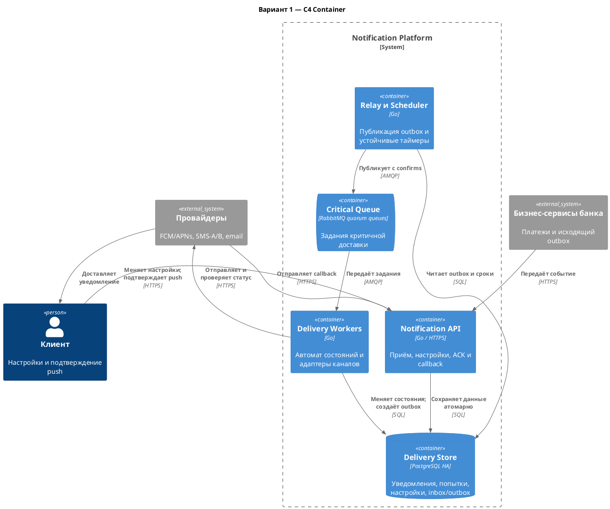
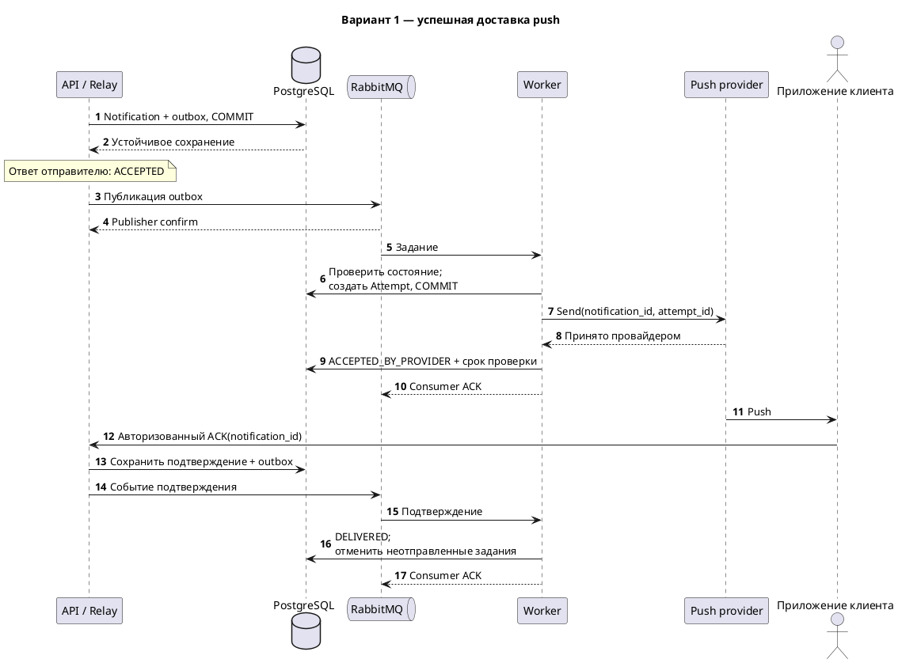
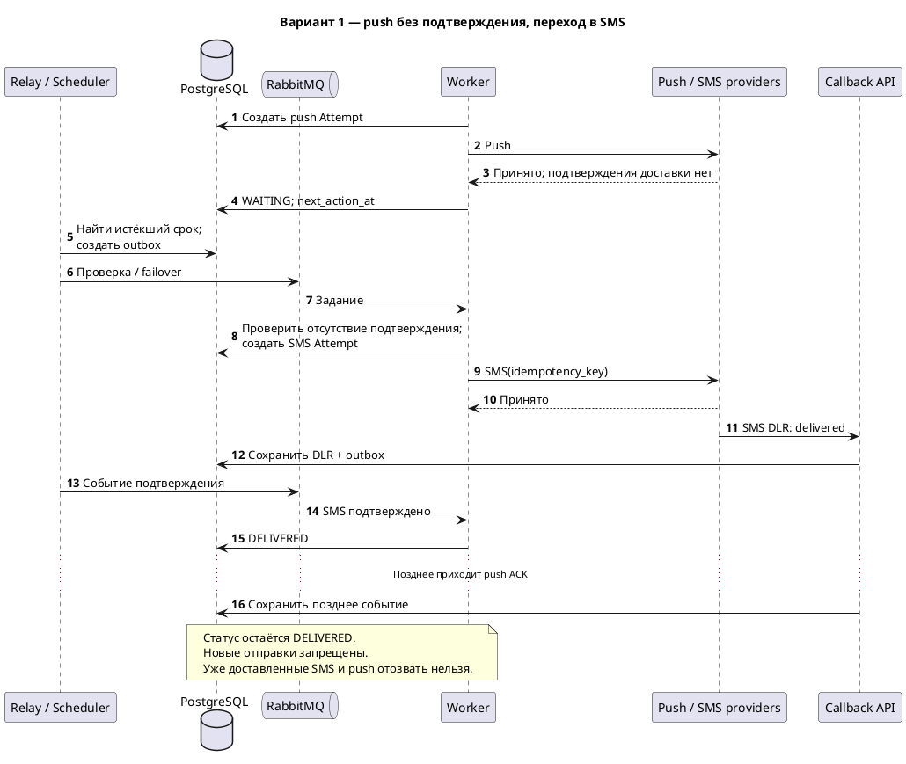
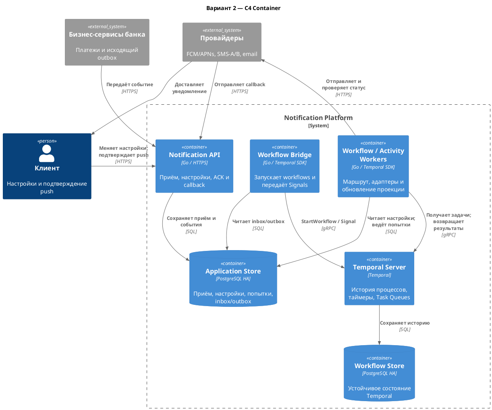
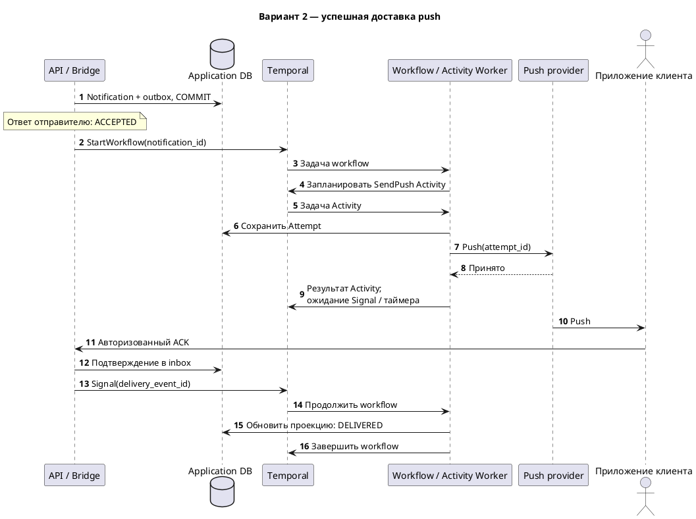
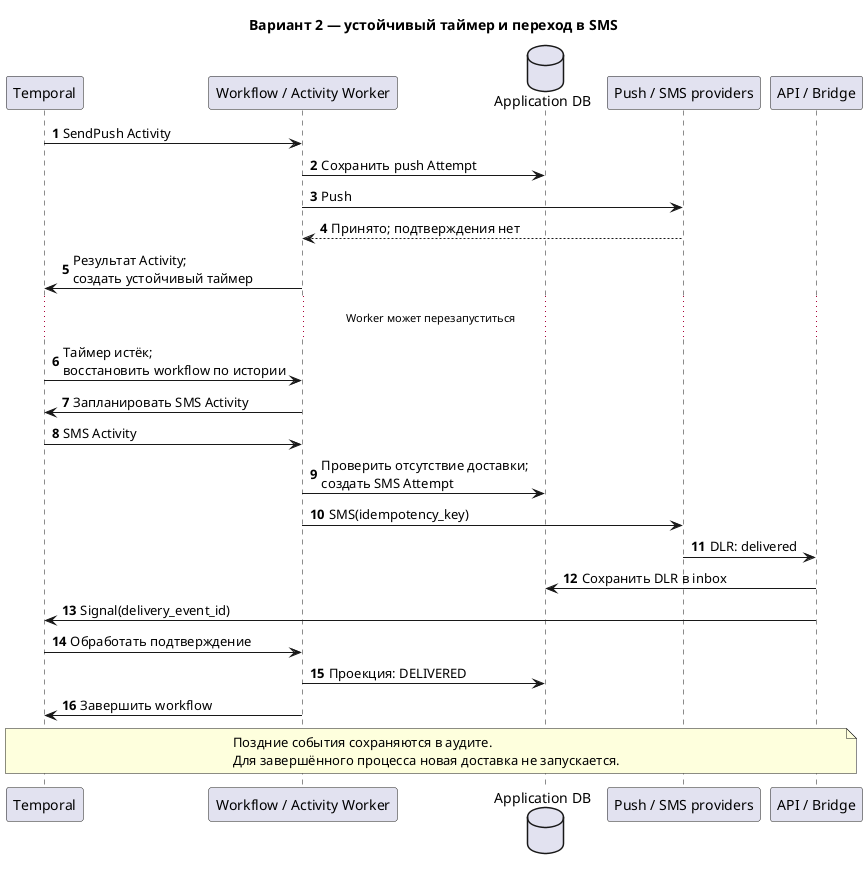

# RFC: Гарантированная доставка критичных уведомлений
# с автоматическим failover между каналами

| Метаданные | Значение |
|---|---|
| Статус | DRAFT |
| Автор | Коган Дмитрий |
| Ответственный | Автор архитектурного проекта |
| Бизнес-заказчик | Владелец клиентского опыта банка — роль, представитель не назначен |
| Ревьюеры | Не назначены |
| Дата создания | 2026-11-17 |
| Дата обновления | 2026-11-17 |

## Оглавление

1. Контекст
2. Продуктовый анализ
3. Пользовательские сценарии
4. Статистика
5. Требования
6. Варианты решения
7. Сравнительный анализ
8. Выводы
9. Связанные задачи
10. Приложения

## Контекст

Сейчас продуктовые команды отправляют уведомления самостоятельно.
Общий статус доставки отсутствует, повторы обрабатываются неодинаково,
сбои провайдеров приводят к задержкам и потерям.

Предлагается единая подсистема доставки критичных уведомлений.
Она принимает событие, сохраняет обязательство по доставке,
выбирает канал, обрабатывает подтверждение и при необходимости
автоматически переключается на резерв.

Граница RFC: доставка транзакционных уведомлений после передачи
события платформе. Система платежей остаётся владельцем бизнес-операции.
Конструктор кампаний и персонализация маркетинга находятся вне RFC;
их влияние на ресурсы учитывается.

Целевой результат — отсутствие тихих потерь, измеримая доставка
и возможность объяснить результат каждой попытки.

## Продуктовый анализ

### Настройки пользователя

| Тип | Полное отключение | Тихие часы | Каналы |
|---|---|---|---|
| Транзакционные критичные | Нет | Не применяются | Пользователь выбирает предпочтительный; резервом служат остальные доступные и подтверждённые контакты |
| Сервисные | Да | Применяются | Только разрешённые пользователем |
| Маркетинговые | Да | Применяются | Только разрешённые пользователем |

Эта классификация является продуктовым решением проекта, а не
утверждением о законодательных требованиях.

Отключение SMS для маркетинга не означает отключение резервного SMS
для сообщения о списании. Различие явно показывается в настройках.
Пользователь может удалить контакт или отозвать разрешение ОС на push:
такой канал становится технически недоступным.

### Стоимость

По умолчанию используется push → SMS → email.
При явном предпочтении другой канал становится первым, затем
применяется порядок оставшихся доступных каналов.
Недействительные контакты и каналы с открытым circuit breaker пропускаются.

Стоимость определяется фактическими платными попытками:

C_day = N_push × c_push + N_sms × c_sms + N_email × c_email.

Например, при переходе в SMS для 10% из 6 млн уведомлений потребуется
600 тыс. SMS в сутки вместо 6 млн при SMS для каждого события.
Это иллюстрация, а не прогноз: доля определяется пилотом.
При массовом отказе push расходы могут приблизиться ко второму значению.

Превышение общего бюджета вызывает оповещение и остановку маркетингового
трафика. Уже принятые критичные уведомления не отбрасываются.

## Пользовательские сценарии

| Приоритет | Тип | Действующее лицо | Сценарий |
|---|---|---|---|
| MUST HAVE | Основной | Клиент банка | После списания получает push; подтверждение останавливает дальнейшие отправки |
| MUST HAVE | Failover | Клиент банка | При отсутствии подтверждения push получает SMS, затем при необходимости email |
| MUST HAVE | Настройки | Клиент банка | Выбирает предпочтительный канал и видит условия использования резервных |
| MUST HAVE | Диагностика | Поддержка | Находит уведомление и видит попытки, подтверждения и причину failover |
| MUST HAVE | Полный отказ | Дежурный инженер | Получает сигнал о недоставке; обязательство остаётся в системе |
| SHOULD HAVE | Оптимизация | Владелец продукта | Сравнивает стоимость, задержки и жалобы по маршрутам |
| COULD HAVE | Рекомендации | Клиент банка | Получает предложение исправить недействительный контакт |

## Статистика

### Исходные данные и расчёт

Базовый расчёт выполняется по DAU = 3 млн.
MAU = 10 млн определяет размер аудитории, но не число ежедневных отправок.
Peak Concurrent Users = 300 тыс. не переводится напрямую в сообщения/с:
для этого нужна частота бизнес-событий.

| Тип | На активного пользователя в день | В сутки | Среднее в секунду |
|---|---:|---:|---:|
| Транзакционные | 2 | 6 000 000 | 69,4 |
| Сервисные | 3 | 9 000 000 | 104,2 |
| Маркетинговые | 5 | 15 000 000 | 173,6 |
| Всего | 10 | 30 000 000 | 347,2 |

Проектный коэффициент пика — 10:

- обычный пиковый поток: 347,2 × 10 ≈ 3 472 уведомления/с;
- кампания на 1 млн за 15 минут: 1 000 000 / 900 ≈ 1 111/с;
- консервативный совместный пик: 3 472 + 1 111 ≈ 4 583/с;
- проектная граница: 5 000 новых уведомлений/с;
- критичный поток: 69,4 × 10 ≈ 694/с; резервируется 1 000/с.

Кампания уже входит в суточный маркетинговый объём.
Добавление её к пиковому потоку — запас на концентрацию отправок,
а не увеличение суточного расчёта.

При трёх попытках на критичное уведомление:

- 1 000 × 3 = 3 000 критичных попыток/с;
- остальные 4 000 уведомлений/с дают суммарно до 7 000 попыток/с;
- целевая пропускная способность адаптеров — 8 000 попыток/с.

Это оценка первого цикла. Отложенные повторы ограничиваются квотами,
чтобы не превратить восстановление после сбоя в новую перегрузку.
Для отказа всего push-канала требуется резерв SMS до 1 000 отправок/с
либо заранее признанное ухудшение SLO.

Если частоты относятся ко всем 10 млн MAU, получится 100 млн/сутки
и примерно 12,7 тыс. новых уведомлений/с с теми же допущениями о пике
и кампании. Такой режим требует отдельного подтверждения мощности.

### Хранение

Допущение: одна критичная запись вместе со средним журналом попыток
занимает 3 КБ без индексов и реплик.

- 6 млн × 3 КБ = 18 ГБ/сутки;
- за 90 дней: 1,62 ТБ;
- с коэффициентом 2 на индексы и тремя копиями: около 9,72 ТБ.

Резервные копии, WAL, содержимое сообщений и некритичный поток
в этот объём не включены. Расчёт уточняется по прототипу.
Таблицы истории разделяются по времени; предусмотрено шардирование
по пользователю. Ключ дедупликации учитывает получателя.

Нужны отдельные испытания БД: 1 000 уведомлений/с означают несколько
тысяч записей и обновлений в секунду, а не только 1 000 INSERT.

## Требования

### Функциональные требования

Базовые FR1–FR10 определены в `01_requirements.md`.
Для подсистемы вводятся уточнения:

| ID | Приоритет | Требование |
|---|---|---|
| RF1 | MUST HAVE | Успех приёма возвращается только после устойчивого сохранения уведомления и задания на обработку |
| RF2 | MUST HAVE | Доступный резервный канал используется автоматически при окончательном отказе или истечении срока ожидания |
| RF3 | MUST HAVE | Подтверждение доставки останавливает ещё не начатые попытки; повторные и поздние события обрабатываются безопасно |
| RF4 | MUST HAVE | Отсутствие подтверждения не превращается в успешную доставку; неразрешённые случаи сохраняются и эскалируются |
| RF5 | SHOULD HAVE | Маршрут и причины его выбора доступны для аудита вместе с версией настроек |

### Нефункциональные требования

Применяются NFR1–NFR9 из `01_requirements.md`.
Основные SLO: доступность приёма 99,99%, первая отправка p99 ≤ 500 мс,
99,95% подтверждённых критичных доставок за 30 с, RPO = 0 при потере
одной зоны, восстановление обработки ≤ 60 с.

Приоритеты ASR сохраняются: A1–A3 — P0, A4–A5 — P1.
Сравнение выполнения каждого ASR приведено ниже.

### Что считается доставкой

| Событие | Смысл | Достаточно для DELIVERED |
|---|---|---|
| Успешный ответ API платформы | Уведомление устойчиво принято | Нет |
| HTTP 2xx / message_id от провайдера | Провайдер принял запрос | Нет |
| Push ACK от авторизованного приложения | Приложение получило конкретное уведомление | Да |
| SMS delivery report | Провайдер подтвердил доставку по согласованной семантике DLR | Да, если это подтверждение доставки терминалу |
| Email delivery event | Получающий почтовый сервер принял сообщение | Да, на уровне почтового транспорта |
| Открытие или прочтение | Действие пользователя | Не требуется |

Email-подтверждение не гарантирует попадание во «Входящие» или прочтение.
Если провайдер сообщает только принятие собственной системой,
это не считается подтверждённой email-доставкой.
Метрики сохраняют уровень доказательства: app_ack, sms_dlr, email_mta.

Гарантируется устойчивый процесс доставки в оговорённой модели отказов.
Получение человеком и безусловная доставка при недоступности всех каналов
не гарантируются. Такие случаи остаются видимыми нарушениями SLO.

### Общий алгоритм маршрутизации

1. Проверить получателя, тип, шаблон и ключ бизнес-события.
2. Сохранить уведомление и задание обработки одной транзакцией.
3. Получить настройки и действующие контакты.
4. Построить маршрут: предпочтительный канал, затем доступный резерв.
5. Создать попытку до обращения к внешнему провайдеру.
6. Отправить сообщение и дождаться достаточного подтверждения.
7. При отказе или истечении срока ожидания перейти к следующему каналу.
8. После подтверждения завершить процесс и отменить неотправленные задания.

В первом цикле разрешено не более одной новой отправки на канал.
Для маршрута по умолчанию бюджет ожидания: push — до 3 с,
SMS — до 10 с, email — оставшееся время в общем окне 30 с.
Таймер канала включает обращение к провайдеру; HTTP timeout — 1,5 с.
При изменении порядка сохраняются абсолютный дедлайн и резерв времени.

Окончательная ошибка, например недействительный токен, вызывает
немедленный переход. Тайм-аут означает UNKNOWN: запрос мог быть принят.
Сначала проверяется статус, если провайдер это поддерживает.
После окончания бюджета выполняется failover с фиксацией риска дубля.

При недоставке за 30 с уведомление остаётся незавершённым.
Повторные циклы планируются через 1, 5, 15 минут, затем с интервалом
до 1 часа и jitter. Автоматическая обработка ограничена 24 часами
и 12 новыми отправками на уведомление.
После лимита — NEEDS_ATTENTION, эскалация и разрешённый оператором повтор.
Незавершённая запись не удаляется и не считается доставленной.

Circuit breaker открывается при доле ошибок ≥ 50% за 30 с
при минимум 20 запросах. Через 30 с допускаются пробные обращения.
Для некритичного трафика и критичного резерва квоты разделены.
Параметры уточняются пилотом.

### Состояние и защита от дублей

Уведомление проходит состояния:

ACCEPTED → IN_PROGRESS → DELIVERED.

Из IN_PROGRESS возможен переход в RETRY_WAIT с возвратом
в IN_PROGRESS, а после исчерпания автоматических попыток —
в NEEDS_ATTENTION. Позднее корректное подтверждение может перевести
незавершённое состояние, включая NEEDS_ATTENTION, в DELIVERED.
Из DELIVERED обратных переходов нет.

Попытка имеет отдельное состояние:
PREPARED, DISPATCHING, ACCEPTED_BY_PROVIDER, UNKNOWN, FAILED, CONFIRMED.

Основные данные:

| Сущность | Значимые поля |
|---|---|
| Notification | notification_id, producer, event_id, user_id, kind, payload_hash, status, version, deadline, policy_version |
| Attempt | attempt_id, notification_id, channel, provider, status, provider_message_id, idempotency_key, next_check_at |
| Outbox / Inbox | event_id, тип события, ссылка на уведомление, время, статус обработки |
| DeliveryEvent | provider_event_id, attempt_id, тип подтверждения, время получения |
| Preferences | user_id, preference_version, предпочтение, разрешения, подтверждённые контакты |

Уникален ключ (producer, event_id, user_id, kind).
Повтор с тем же ключом и содержимым возвращает прежний notification_id;
с другим содержимым — конфликт.
Ключ хранится 90 дней, для незавершённого случая — до разрешения.
Повторная подача событий старше окна не разрешается обычным API.

Повтор обращения к тому же провайдеру после неопределённого результата
использует тот же attempt_id и ключ идемпотентности.
Новая попытка после доказанного отказа получает новый ключ.
Если провайдер не поддерживает идемпотентность или срок её действия истёк,
слепой повтор запроса с неизвестным результатом запрещён:
сначала проверка статуса либо контролируемый failover.

Переходы состояния сериализуются для notification_id.
Перед новой отправкой проверяется актуальное состояние.
Повторные callback устраняются по идентификатору события;
поздний FAILED не отменяет уже полученный CONFIRMED.

Уже переданное внешнему провайдеру сообщение нельзя надёжно отозвать.
Поэтому поздний push и уже отправленное SMS могут оба дойти до клиента.
Уведомления используют общий notification_id; приложение подавляет
повторное отображение этого идентификатора.
Для SMS/email абсолютная межканальная дедупликация недостижима.
Выбран приоритет доставки над абсолютным отсутствием видимых повторов.

### Отказы и безопасность

Бизнес-сервис сохраняет событие в собственный outbox вместе с платежом
и повторяет передачу до подтверждения платформой.
Платформа регулярно сверяет незавершённые записи и задания:
наличие записи в БД позволяет восстановить обработку после сбоя брокера.

Callback проверяется по подписи, времени и уникальному event_id.
Push ACK связывается с авторизованным пользователем и notification_id.
Полученное подтверждение сохраняется до ответа об успешном приёме.

PostgreSQL работает с синхронной репликацией между зонами;
продвижение отставшей реплики запрещено.
Управление лидером требует fencing, чтобы исключить двух писателей.
При невозможности безопасного подтверждения API возвращает ошибку,
а отправитель сохраняет событие в outbox.

RPO = 0 относится к отказу одной зоны, не к полной потере региона.
Для региональной катастрофы принимается отдельный DR:
RPO ≤ 60 с, RTO ≤ 60 минут, сверка с outbox источников после восстановления.

Обычные логи содержат идентификаторы и коды ошибок.
Текст и контакты доступны только авторизованным компонентам.
Метаданные закрытых случаев хранятся 90 дней, содержимое — 7 дней.
Незавершённые случаи сохраняются до разрешения с ограниченным доступом.

## Варианты решения

### Вариант 1: RabbitMQ и собственный автомат доставки

#### Архитектура

Технологии: Go, PostgreSQL, RabbitMQ quorum queues,
OpenTelemetry, Prometheus, Grafana, Loki и Tempo.

PostgreSQL — источник истины.
API записывает уведомление и outbox одной транзакцией.
Relay публикует задания с publisher confirms и проверкой маршрутизации.
RabbitMQ использует quorum queues с тремя репликами.
Consumer подтверждает сообщение после устойчивого сохранения результата.

Воркеры выполняют автомат состояний, выбирают канал и вызывают адаптер.
Таймеры хранятся в БД как next_action_at.
Scheduler выбирает готовые записи через SELECT ... FOR UPDATE SKIP LOCKED
и создаёт задания через outbox. Таймеры не зависят от жизни процесса.

Длительный внешний вызов не выполняется под блокировкой строки БД.
Перед ним фиксируется попытка и право её обработки.
Истечение lease не разрешает слепую повторную отправку:
сначала проверяется исход предыдущего вызова.

Критичные очереди, пулы воркеров и квоты независимы от кампаний.
Для дальнейшего масштабирования задания распределяются по
hash(notification_id). Настройки и payload передаются по ссылке,
а не дублируются во всех сообщениях.

#### C4 Container

#### Sequence: основной сценарий

Участник Ingress объединяет API и relay только для компактности диаграммы.

#### Sequence: failover

#### Этапы реализации

| Этап | Описание | Срок | Ресурсы | Риски |
|---|---|---|---|---|
| 1 | Контракты, модель данных, критерии подтверждения | 1 неделя | 2 backend, аналитик, SRE | Неоднозначная семантика DLR |
| 2 | API, outbox, очереди, автомат, настройки | 2 недели | 2 backend, SRE | Ошибки гонок и восстановления |
| 3 | Адаптеры, callback, аудит и метрики | 2 недели | 2 backend, QA | Ограничения провайдеров |
| 4 | Нагрузочные и аварийные испытания, пилот | 2 недели | Backend, QA, SRE | Недостаточная мощность БД |

Итого: ориентировочно 7 недель при доступной инфраструктуре.
Сроки — оценка, зависящая от интеграций.

#### Преимущества

- Один источник истины и понятная история попыток.
- Повторное использование распространённых БД и брокера.
- Прямой контроль квот, стоимости и поведения при неопределённом исходе.

#### Недостатки

- Таймеры, переходы и восстановление нужно разрабатывать самостоятельно.
- Высокая цена ошибок конкурентной обработки.
- Необходима оптимизация истории и индексов при миллионах записей в сутки.

### Вариант 2: Temporal и долговечные процессы доставки

#### Архитектура

Технологии: Go, Temporal Server, Temporal Go SDK, PostgreSQL
для Temporal и отдельная прикладная БД PostgreSQL.
Наблюдаемость — тот же стек OpenTelemetry, Prometheus, Grafana, Loki, Tempo.

API сохраняет уведомление и outbox.
Bridge запускает workflow с Workflow ID = notification_id.
Повтор запуска не создаёт второй процесс.
Прикладной ключ дедупликации хранится независимо от срока хранения
истории Temporal.

Workflow хранит последовательность каналов, таймеры и результаты.
Внешние вызовы выполняются Activities.
Callback сначала записывается в прикладной inbox, затем bridge
передаёт Signal в workflow. При отсутствии запущенного workflow
сигнал остаётся в inbox и повторяется.

Отдельный брокер для критичного процесса не нужен:
задания распределяются через Temporal Task Queues.
Для кампаний используется отдельный контур.
Истина о ходе процесса находится в Temporal; прикладная БД содержит
приём, журнал внешних попыток и проекцию для поиска и поддержки.

Activity может выполняться повторно. Перед внешним вызовом сохраняется
attempt_id; запрос к провайдеру защищается тем же ключом идемпотентности.
Автоматический retry отправки не применяется безусловно:
UNKNOWN сначала требует проверки статуса.
Завершение workflow не отзывает запрос, уже принятый провайдером.

#### C4 Container

#### Sequence: основной сценарий

#### Sequence: failover

#### Этапы реализации

| Этап | Описание | Срок | Ресурсы | Риски |
|---|---|---|---|---|
| 1 | Пилот Temporal, модель истории и нагрузка | 2 недели | 2 backend, SRE | Неизвестная стоимость хранения |
| 2 | Workflows, Activities, inbox/outbox, адаптеры | 3 недели | 2 backend, QA | Ошибки retry внешних действий |
| 3 | HA, наблюдаемость, обновление workflow-кода | 2 недели | Backend, SRE | Несовместимость изменений с историей |
| 4 | Нагрузочные и аварийные испытания, пилот | 2 недели | Backend, QA, SRE | Недостаточная производительность |

Итого: ориентировочно 9 недель при отсутствии опыта Temporal.

#### Преимущества

- Встроенные устойчивые таймеры и восстановление процесса.
- Удобное описание последовательности каналов и ожидания событий.
- Меньше собственного кода инфраструктуры повторов.

#### Недостатки

- Дополнительная платформа и компетенции эксплуатации.
- История миллионов workflow создаёт нагрузку на хранение.
- Требуется управление совместимостью версий workflow-кода.
- Идемпотентность внешних отправок всё равно разрабатывается отдельно.

## Сравнительный анализ

### Ресурсные требования

| Критерий | Вариант 1 | Вариант 2 |
|---|---|---|
| Время реализации | Около 7 недель | Около 9 недель |
| Команда | 2 backend, QA, SRE; аналитик на старте | Такой же состав с дополнительной компетенцией Temporal |
| Инфраструктура | PostgreSQL HA, RabbitMQ quorum, API и воркеры | Temporal Server, его PostgreSQL HA, прикладной PostgreSQL HA, API и воркеры |
| Таймеры | Собственный scheduler | Устойчивые таймеры Temporal |
| Хранение истории | Прикладной журнал | Прикладной журнал и история workflow |
| Организационный риск | Ошибки собственного автомата | Освоение и сопровождение новой платформы |

Размеры узлов и число шардов определяются испытаниями.
Наличие выбранной технологии само по себе не доказывает выполнение SLO.

### Соответствие каждому ASR

| ASR | Вариант 1 | Вариант 2 |
|---|---|---|
| A1, P0: задержка и масштаб | Изолированные очереди и воркеры, квоты, шардирование заданий | Отдельные Task Queues и воркеры; необходимо проверить нагрузку на Temporal persistence |
| A2, P0: сохранность | PostgreSQL HA, outbox, quorum queues, устойчивые сроки и сверка незавершённых записей | Устойчивый приём, outbox, история workflow, timers и replay |
| A3, P0: согласованность | Уникальные ключи, атомарные переходы, журнал попыток и дедупликация callback | Один workflow на уведомление плюс прикладная дедупликация и идемпотентные Activities |
| A4, P1: настройки и стоимость | Политика маршрутизации внутри Delivery Workers | Та же политика в workflow; актуальные настройки читаются через Activity |
| A5, P1: аудит и безопасность | Прикладной аудит, OTel, RBAC, шифрование | Прикладной аудит и история Temporal; доступ к истории также ограничен |

В обоих вариантах A3 имеет одинаковое внешнее ограничение:
после неоднозначного ответа провайдера невозможно одновременно
безусловно гарантировать доставку и отсутствие межканального дубля.

### Покрытие функциональных и нефункциональных требований

| Требования | Механизм в обоих вариантах |
|---|---|
| FR1, FR9; NFR7 | API статуса, история попыток, метрики и трассировка |
| FR2, FR8; NFR2, NFR3 | Изоляция критичного потока от кампаний |
| FR3, FR6; NFR1, NFR4 | Устойчивый процесс, адаптеры каналов, failover и восстановление |
| FR4, FR5; NFR6 | Общая модель настроек и проверка перед отправкой |
| FR7; NFR5 | Дедупликация бизнес-событий, попыток и подтверждений |
| FR10; NFR9 | Маршрутизация по стоимости и учёт платных попыток |
| NFR8 | Шифрование, аутентификация, права доступа, защищённые callback |

## Выводы

Выбирается вариант 1: PostgreSQL, RabbitMQ и собственный автомат доставки.

Основания:

1. Процесс ограничен тремя каналами и небольшим числом состояний.
2. PostgreSQL хранит единую историю приёма и попыток.
3. Можно независимо масштабировать критичный поток и кампании.
4. В рамках проекта предполагается наличие опыта PostgreSQL и RabbitMQ,
   тогда как Temporal потребует освоения.

Главный компромисс — самостоятельная реализация таймеров, восстановления
и конкурентных переходов. Поэтому запуск возможен только после
испытаний гонок, повторной доставки событий и аварийного восстановления.

Если Temporal уже эксплуатируется в банке либо процесс расширится
до множества длительных согласований и каналов, выбор следует пересмотреть.

Ни один вариант не обеспечивает прочтение сообщения человеком.
Недоступность всех контактов остаётся операционным случаем,
а поздняя внешняя доставка — источником возможного видимого дубля.
Эти случаи измеряются и не скрываются за статусом успешной обработки.

## Связанные задачи

Ниже — план работ; записи не являются созданными задачами во внешней системе.

| ID | Задача | Критерий готовности |
|---|---|---|
| NP-01 | Согласовать классификацию и подтверждения доставки | Для каждого канала определено, какой сигнал завершает доставку |
| NP-02 | Реализовать входной контракт и outbox | Повтор события возвращает прежний ID; сбой между записью и публикацией не теряет уведомление |
| NP-03 | Реализовать автомат, таймеры и адаптеры | Основной маршрут и все переходы failover воспроизводимы |
| NP-04 | Добавить настройки, аудит и защиту | Проверены права, подписи callback и применение настроек за 5 с |
| NP-05 | Провести нагрузочные и аварийные испытания | Подтверждены NFR1–NFR8 на согласованном стенде |
| NP-06 | Выполнить постепенное внедрение | 1% → 10% → 50% → 100% критичного трафика без одновременной отправки старой и новой системой |

### Обязательные проверки перед внедрением

- Падение процесса после commit, но до публикации outbox.
- Падение после принятия запроса провайдером, но до записи ответа.
- Повторные, поздние и переставленные callback.
- Одновременное срабатывание таймера и подтверждения push.
- Отказ одной зоны без потери подтверждённых приёмов.
- Отказ push с массовым переходом на SMS и ограничением квот.
- Кампания на 1 млн пользователей одновременно с критичным пиком.
- Изменение настроек непосредственно перед отправкой.
- Восстановление после накопления очереди без лавины повторов.

При откате прекращается приём новых событий новым маршрутом,
но уже принятые уведомления доводятся до разрешения тем же владельцем.
Старая и новая системы не отправляют одно событие одновременно.

### Наблюдаемость

Основные показатели: задержка первой попытки и подтверждения,
доля доставок за 30 с, возраст старейшего задания, UNKNOWN,
число failover, доля NEEDS_ATTENTION, стоимость и ошибки провайдеров.

Аварийные сигналы:

- возраст критичного задания > 1 с в течение минуты;
- доля недоставленных за 30 с > 0,05% на контрольном окне;
- недоступность резервного канала;
- рост UNKNOWN или NEEDS_ATTENTION;
- нарушение репликации или остановка outbox.

При малом числе событий долевой сигнал дополняется абсолютным числом
ошибок. Метрики не используют user_id и notification_id как labels:
эти идентификаторы остаются в защищённых логах и трассировках.

## Приложения

### Глоссарий

| Термин | Определение |
|---|---|
| ASR | Требование, существенно определяющее архитектуру |
| SLO | Измеримая целевая характеристика сервиса |
| Failover | Переход на резервный канал или поставщика |
| Outbox | Задание, записанное одной транзакцией с исходными данными |
| Inbox | Устойчивое хранение входящего события перед обработкой |
| Идемпотентность | Повтор операции не создаёт нового бизнес-эффекта |
| ACK / DLR | Подтверждение получения / отчёт о доставке SMS |
| RPO / RTO | Допустимая потеря данных / время восстановления |
| Circuit breaker | Временное прекращение обращений к сбоящей зависимости |
| Fencing | Запрет устаревшему владельцу выполнять новые действия |

### Источники

Шаблон прочитан из ранее загруженного файла
`rfc_template-eea98023-983f-40ce-a6cc-59afc8796642(1).md`.

- Шаблон задания: https://edu.tbank-online.com/files/eea98023-983f-40ce-a6cc-59afc8796642
- RabbitMQ, подтверждения: https://www.rabbitmq.com/docs/confirms
- RabbitMQ, quorum queues: https://www.rabbitmq.com/docs/quorum-queues
- PostgreSQL, синхронная репликация: https://www.postgresql.org/docs/current/warm-standby.html
- Temporal, Activities и идемпотентность: https://docs.temporal.io/activity-definition
- Firebase, принятие и срок жизни push: https://firebase.google.com/docs/cloud-messaging/customize-messages/setting-message-lifespan
- C4-PlantUML: https://github.com/plantuml-stdlib/C4-PlantUML

Показатели нагрузки, SLO, сроки и политики — авторские проектные
допущения. Документация технологий подтверждает свойства механизмов,
но не производительность предложенной конфигурации.
